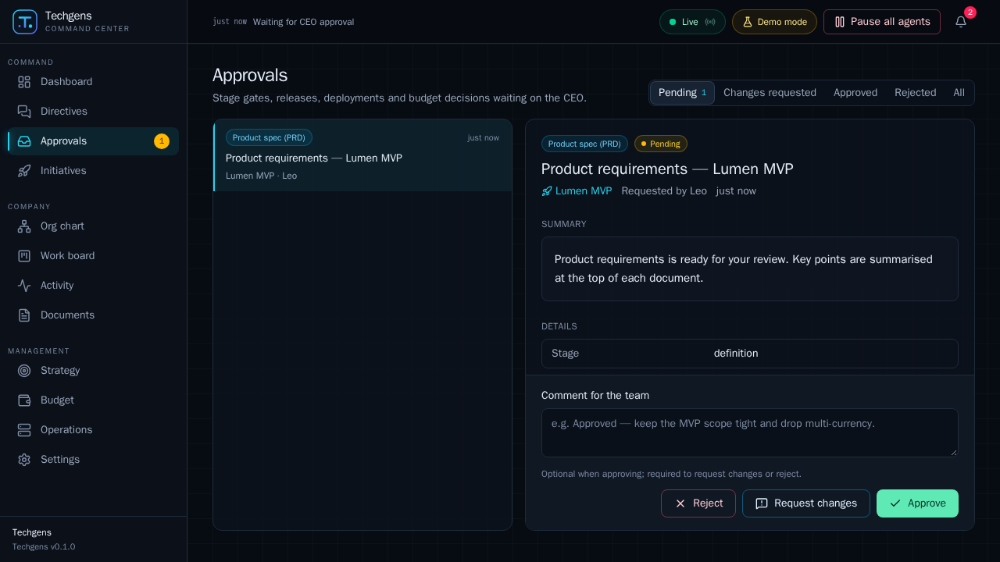
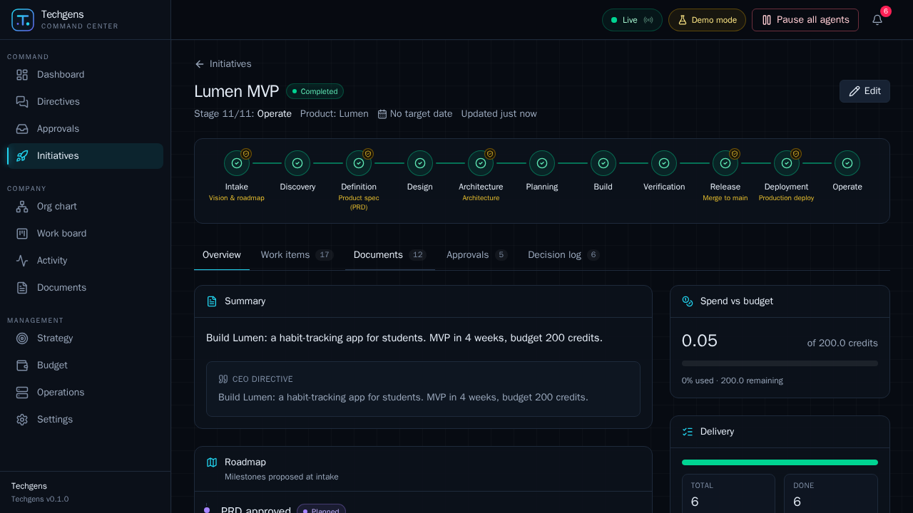
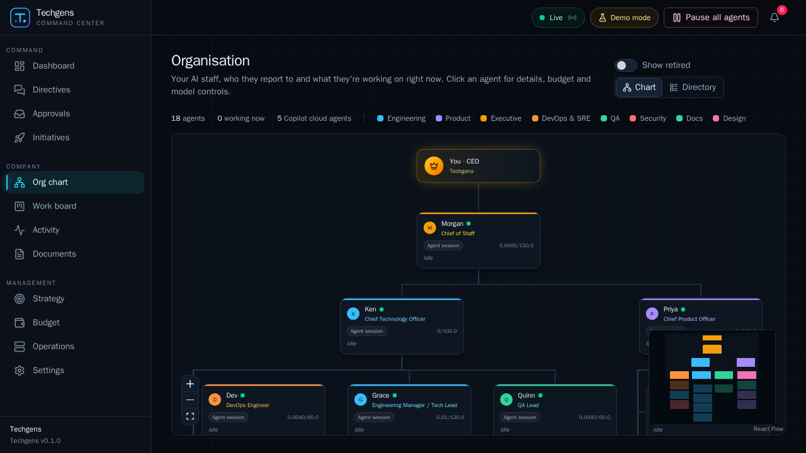
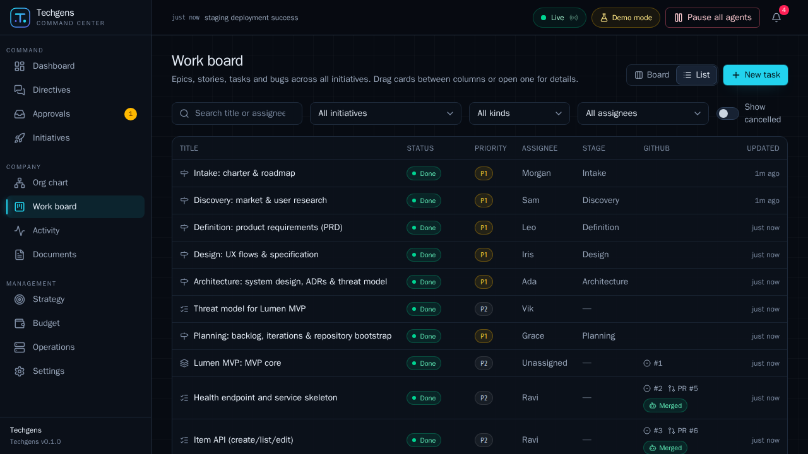

# Techgens

**An AI-staffed product company you run as CEO.** Techgens is a self-hosted app where you set the vision, goals,
timelines, budgets and policies, and a hierarchy of AI agents (Chief of Staff, CPO, Product Manager, Analyst, UX
Designer, CTO, Architect, Engineering Manager, Copilot-powered engineers, QA, DevOps, SRE, Security, Technical Writer)
researches, specifies, designs, builds, tests, ships and operates products — with you approving every key gate.

- **Runs on your GitHub Copilot subscription** through the [GitHub Copilot SDK](https://github.com/github/copilot-sdk).
  No other model keys needed.
- **Real software delivery**: engineering work becomes GitHub issues assigned to **Copilot cloud agent**; pull requests
  are reviewed and merged by your agents; products deploy to **Azure Container Apps** through GitHub Actions.
- **You stay in control**: approval gates for vision/roadmap, specs, architecture, merges to `main`, production
  deploys and budget overruns; per-agent/department/initiative budgets in Copilot AI credits; a global pause switch.

```
CEO ──▶ Command Center (Next.js) ──▶ Orchestrator (Fastify · Postgres · pg-boss)
                                        ├─ Org chart, work graph, stage-gate lifecycle, approvals, budgets
                                        ├─ Agents ─▶ Copilot SDK sessions (Techgens tools only)
                                        └─ Delivery ─▶ GitHub (issues → Copilot cloud agent → PRs → Actions) ─▶ Azure
```

| Approve every key gate | Watch the company work |
|---|---|
|  |  |
|  |  |

## Quick start

**Try it first in demo mode**: the agents follow scripts and GitHub is simulated, so it spends no Copilot credits and
touches no real repositories. All you need is Docker (or a GitHub Codespace).

```sh
git clone https://github.com/FaheemR/techgens.git && cd techgens
cp .env.example .env                  # then set AGENT_RUNTIME=fake in .env
docker compose up -d --build          # first build: about 3–6 minutes
```

Open **http://localhost:3000**, give the Chief of Staff a directive (*"Build InvoiceLite: invoicing SaaS for
freelancers. MVP in 6 weeks, budget 400 credits."*) and approve the gates as they arrive in **Approvals**.

No Docker? Open the repository in **GitHub Codespaces** (Code → Codespaces), run
`AGENT_RUNTIME=fake docker compose up -d --build` in its terminal and open port 3000 from the **Ports** tab.

➡️ **[Getting started](docs/getting-started.md)**: a guided 10-minute tour, switching to real Copilot agents, and
troubleshooting.

### Real agents

1. In `.env` set `AGENT_RUNTIME=copilot` (start fresh with `docker compose down -v`) and `docker compose up -d`.
2. **Settings → GitHub**: paste a fine-grained personal access token *owned by your user* with the **Copilot
   Requests** account permission, plus repository permissions (Administration, Contents, Issues, Pull requests,
   Actions, Environments, Variables, Workflows: read & write) on the owner of product repositories — or use
   **Create GitHub App** for a bot identity (`<app>[bot]`) and automatic token refresh.
3. **Strategy**: set the company name, mission, values and the *policies* (the company "constitution" injected into
   every agent prompt and every product repo as `.github/copilot-instructions.md`), then give your first directive.

## How it works

| Concept | Where |
|---|---|
| Roles-as-code (prompt, tools, model, budget, executor) | [`packages/agents/roles/*.md`](packages/agents/roles) |
| Lifecycle stages & gates | [`packages/core/src/lifecycle.ts`](packages/core/src/lifecycle.ts) |
| Job engine (delegation, waits, resumes, guardrails) | [`apps/orchestrator/src/engine`](apps/orchestrator/src/engine) |
| Agent tools (26) | [`packages/tools`](packages/tools) |
| Copilot SDK adapter + scripted fake | [`packages/runtime`](packages/runtime) |
| GitHub integration (Octokit, App flow, simulator) | [`packages/github`](packages/github) |
| Product repo template (CI, CodeQL, azd/Bicep, deploy) | [`packages/repo-template`](packages/repo-template) |
| Azure connection script generator | [`packages/azure`](packages/azure) |
| REST/SSE API | [`docs/api.md`](docs/api.md) |

More: [getting started](docs/getting-started.md) · [architecture](docs/architecture.md) ·
[CEO operating manual](docs/operating-manual.md) · [GitHub, Copilot & Azure setup](docs/setup.md) ·
[authoring roles](docs/roles.md) · [prior-art research](docs/research/prior-art.md).

## Development

```sh
npm i -g pnpm@12 && pnpm install
docker run -d --name techgens-pg -e POSTGRES_USER=techgens -e POSTGRES_PASSWORD=techgens -e POSTGRES_DB=techgens -p 5432:5432 postgres:17-alpine
pnpm dev                                  # orchestrator :4000 (tsx watch) + web :3000
AGENT_RUNTIME=fake pnpm dev              # demo mode
pnpm typecheck && pnpm test              # tests need Postgres at TEST_DATABASE_URL (default 127.0.0.1:55432)
```

`packages/runtime/scripts/smoke.ts` checks your Copilot connection (auth + model list, no credits):
`GH_TOKEN=<token> pnpm --filter @techgens/orchestrator exec tsx ../../packages/runtime/scripts/smoke.ts`.

## Safety notes

- Ports are bound to `127.0.0.1`; the API has no login — do not expose it to a network.
- Local agents only get Techgens tools (and read-only `web_fetch` for research roles) — never shell or file access.
- Repository, issue and pull-request text is treated as untrusted input in every prompt.
- Agents can merge only into the integration branch; merges to `main` and production deploys execute with your
  identity after your approval. Tokens are encrypted at rest (AES-256-GCM).
- Set a GitHub billing budget for Copilot as a hard backstop to Techgens' own budgets.

## Acknowledgements

Role prompts adapt ideas from [github/awesome-copilot](https://github.com/github/awesome-copilot) (MIT); the stage
artifacts follow [github/spec-kit](https://github.com/github/spec-kit) and BMAD-METHOD conventions (MIT); governance
patterns (execution policies, approvals, budgets) are inspired by [Paperclip](https://github.com/paperclipai/paperclip)
(MIT). See [THIRD_PARTY_NOTICES.md](THIRD_PARTY_NOTICES.md).
