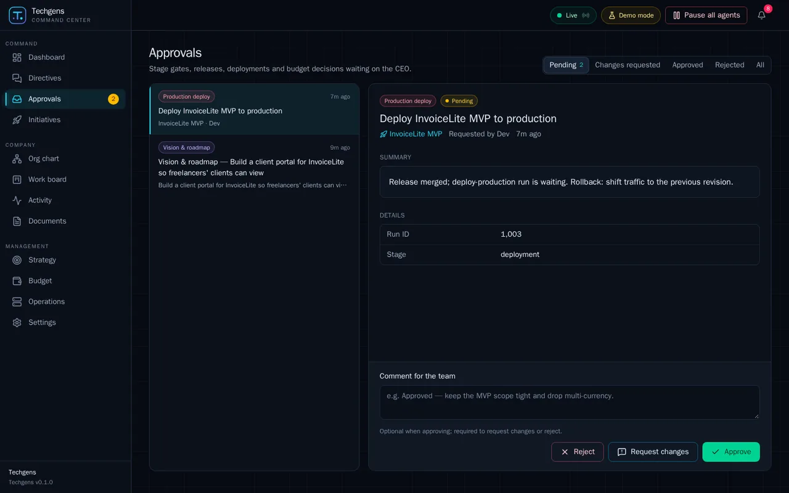
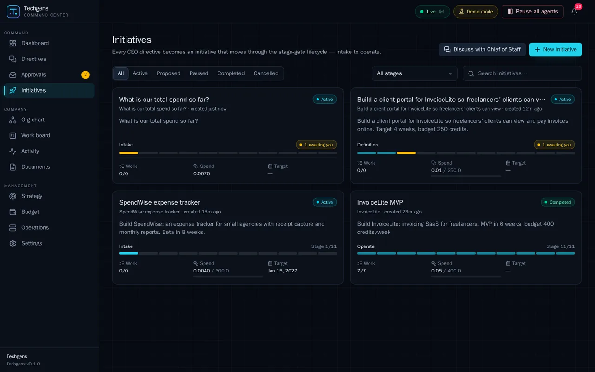
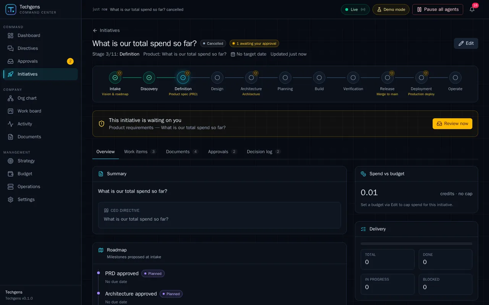
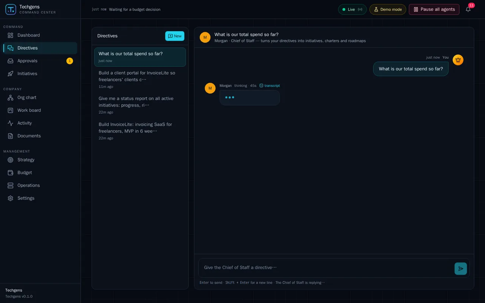
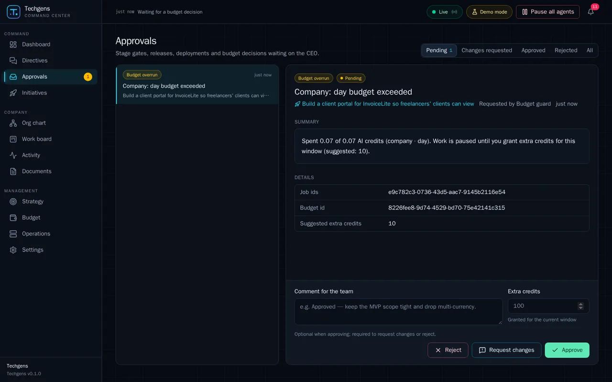
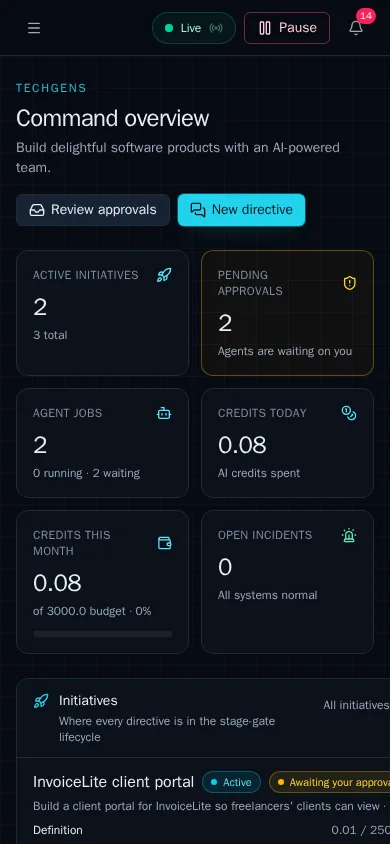

# Techgens Command Center — UI/UX evaluation

| | |
|---|---|
| **Build evaluated** | Production build at `http://localhost:3000` (Next.js 16 / React 19 / Tailwind 4), demo mode (scripted agents, simulated GitHub), web v0.1.0 |
| **Date** | 3 Nov 2026 |
| **Evaluator** | Senior UX (enterprise SaaS, workflow/approval tools, WCAG 2.2) |
| **Methods** | Task-based cognitive walkthroughs (8 journeys), Nielsen heuristic evaluation, WCAG 2.2 AA spot audit (keyboard, focus, semantics, computed-colour contrast, reflow), responsive review at 5 viewports, visual & content review, console/network check |
| **Tooling** | Playwright (Chromium) with accessibility snapshots, scripted `getComputedStyle` contrast measurement (alpha-composited backgrounds), iframe reflow measurement, event instrumentation; source read for root-cause hints only |
| **Data created through the UI** | 3 directives/initiatives (InvoiceLite MVP — completed through all 11 stages with 6 gate decisions incl. 1 *Request changes*; InvoiceLite client portal — mid-flight at PRD gate; SpendWise — *Rejected* at vision gate then cancelled; plus an accidental initiative created by asking a question — cancelled), 1 CEO task, 1 objective + 1 KR, 1 incident (opened → mitigated → resolved), 1 routine enabled + run, 1 hire (Avery), agent pause/resume & budget override, budget-overrun approval |
| **Restored afterwards** | Temporary company daily budget (0.07 cr) deleted via UI; onboarding flag, company values, agent Wren (status/override), gate policy all back to original values |

Screenshots referenced below are in this folder (`NN-*.webp`, `R*-*.webp` = responsive, `F*-*.webp` = finding evidence).

> **Status.** This review covers v0.1 (`5159de0`).
>
> - The fixes were **re-tested by the same evaluator**: 19 findings fixed, 13 partially fixed, 5 open, no regressions; UX maturity rose from 3 to 3.5 (see the [re-test report](retest/README.md)).
> - A follow-up round then fixed the re-test's new issues N1–N13 and most of the partial items: F11, F12, F16, F18, F21, F25, F26, F27, F31 and F36. F12's root cause was toasts sitting over the decision buttons. Automated tests and headless browser checks verify this round; the evaluator has not re-scored it yet.
> - **Still open:**
>   - F19: a "Needs attention" dashboard.
>   - F20: retiring agents.
>   - F28: entity links and thread management in chat.
>   - F35: truncated document titles.
>   - F37: an onboarding checklist and key-result baselines.
>   - The rest of F01: risk and recommendation blocks, and richer vision/PRD briefs.

---

## 1. Executive summary

**Verdict.** Command Center is a well-engineered, visually coherent product with a genuinely good *mental model* (directive → initiative → stage gates → CEO inbox) and strong traceability between chat, initiatives, approvals, documents, jobs and transcripts. Day-to-day mechanics are fast (≈2 clicks per gate decision, sub-second page loads, clean console). **However, it is not yet trustworthy for the high-stakes decisions it exists for.** The CEO is asked to approve merges to `main`, production deploys and budget overruns with almost no decision evidence; several state-integrity gaps (rejected initiatives stay "Active", cancelled initiatives keep pending gates, the chat says "thinking…" while work is actually blocked on the CEO) undermine the "know at a glance what's happening / what's blocked" job; governance switches that remove CEO oversight can be flipped with one click and no feedback. Mobile reflow and a handful of WCAG 2.2 AA failures (the product's own constitution mandates AA) complete the picture.

**UX maturity: 3 / 5 ("defined").** Consistent design system, good foundations and patterns; decision-quality content, state integrity, error prevention and responsive hardening are the gap to a CEO-grade product (4/5).

### Top 5 strengths
1. **Approvals inbox done right at the mechanical level** — mail-client master/detail with auto-select and auto-advance, kind/status badges, attached documents rendered inline with tabs, *Round 2* badge and decision history, mandatory comment for Reject/Request changes with inline error and focus to the field, and a Reject confirmation that steers to "Request changes" ([11](11-approvals-vision-detail.webp), [14](14-approvals-request-changes-validation.webp), [16](16-approvals-round2-history.webp), [31](31-reject-confirm-dialog.webp)). The request-changes → revised round-2 loop completed in ≈2 s.
2. **Clear, honest IA and global chrome** — three nav groups (Command / Company / Management) with a pending-approvals badge; top bar with *Live* indicator, *Demo mode* badge, notifications and an always-available **Pause all agents** kill switch that is immediate, unmissable (banner + green *Resume agents*) and reversible in one click ([58](58-pause-all.webp)).
3. **End-to-end traceability** — initiative ↔ approvals ↔ documents (with versions) ↔ work items ↔ jobs ↔ step-by-step transcripts; lifecycle stepper with gate markers and a "This initiative is waiting on you — Review now" banner ([19b](19b-initiative-detail-full.webp), [42](42-job-transcript.webp), [45](45-document-viewer.webp)).
4. **Solid accessibility and front-end foundations** — skip link, landmarks, native modal `<dialog>` (focus trap + Escape), labelled fields (0 unlabelled controls / 0 unnamed buttons on audited pages), visible 2 px focus rings (≈10.9:1), `role="log"` chat, a screen-reader data table behind the spend chart, most text ≥ 5.5:1; TTFB 19 ms, LCP 0.66 s, no console errors except expected 4xx on error pages.
5. **Good empty states and guided input** — empty dashboard/approvals/incidents copy explains what will appear and why; suggested directive prompts that *prefill* rather than auto-send; "Prefer a form? Create an initiative directly"; constitution editor with Write/Preview/Split and a sticky unsaved-changes bar ([01](01-dashboard-empty-1440.webp), [06](06-chat-empty.webp), [04](04-strategy-dirty-savebar.webp)).

### Top 10 issues
1. **Critical — High-stakes gates have no decision evidence.** Merge to main = "Release PR is green…" + "PR number 8" (no link, diff, checks, release notes); Production deploy = "Run ID 1,003"; Budget overrun = raw Job/Budget UUIDs (F01).
2. **High — Rejecting a gate leaves a zombie "Active" initiative** with no blocked/rejected state, no next step; it keeps counting as active (F02).
3. **High — Cancelling an initiative leaves its pending gate in the CEO inbox** ("Cancelled" + "1 awaiting your approval" + "Review now") (F03).
4. **High — Approval gates (incl. Production deploy) can be switched off with one click**: no confirmation, no toast, no undo, no audit entry (F04).
5. **High — Chat shows "Morgan thinking · 45s" while the job is actually blocked** on a budget decision or global pause; no link to the blocker (F05).
6. **High — Any chat message can spawn an uncapped initiative (and a product) without confirmation**; "What is our total spend so far?" became an initiative; "400 credits/week" became a 400-credit total cap (F06).
7. **High — Budget-overrun grant is misleading**: input placeholder "100" vs "Suggested 10"; leaving it empty silently grants 10; no spend breakdown (F08).
8. **High — Mobile reflow fails (WCAG 1.4.10)**: page-level horizontal overflow on 6 pages at 390 px (Initiatives 567 px, Budget 656 px, Activity 785 px) (F07).
9. **High — Form fields fail non-text contrast (WCAG 1.4.11)**: input border 1.32:1, switch-off track 1.17:1; notification badge text 3.75:1 (F09, F10).
10. **Medium — Focus management**: every dialog opens on "Close dialog" (root cause found), focus drops to `<body>` after each approval decision; decision comment intermittently not registered on first submit (F11, F12).

### Key evidence

| F01 — Production-deploy gate: the whole brief | F02 — Rejected initiative still "Active" | F03 — Cancelled, yet "waiting on you" |
|---|---|---|
|  |  |  |
| **F05 — "thinking · 45s" while blocked on a budget gate** | **F08 — Placeholder 100 vs suggested 10; raw IDs** | **F07 — Dashboard overflows at 390 px (433 px wide)** |
|  |  |  |

---

## 2. Scorecard

Scale: 5 = excellent, 4 = good with minor issues, 3 = workable with notable problems, 2 = significant problems, 1 = failing.

| # | Heuristic | Score | Rationale |
|---|---|:-:|---|
| H1 | Visibility of system status | **3** | Live indicator, event ticker, badges, toasts and the pause banner are excellent; but blocked/rejected states are invisible (zombie "Active" initiatives, chat "thinking" while blocked, cancelled initiatives "waiting on you"). |
| H2 | Match between system and real world | **3** | Top-level language fits a CEO (Directives, Approvals, Initiatives, Budget); deeper levels leak engineering internals: UUIDs, `job.waiting`/`usage.recorded` codes, tool names in task descriptions, "Delegation depth", "orchestrator host", `0.0020 credits on fake-standard`. |
| H3 | User control and freedom | **3** | Pause/resume at company, initiative and agent level; cancel with confirm; request changes. No undo for decisions or settings, agents can be hired but never retired, chat threads can't be renamed/deleted. |
| H4 | Consistency and standards | **3** | Visual system is consistent; behaviour is not: autosave vs explicit save varies by card, counts disagree between views, amber/rose carry 4–5 meanings each. |
| H5 | Error prevention | **2** | Oversight-removing gate toggles without confirm; questions spawn initiatives; misleading grant default; orphan gates after cancel. |
| H6 | Recognition rather than recall | **4** | Context travels well (breadcrumbs, linked entities, inline documents, kind badges); weak spots are identical card titles ("Intake: charter & roadmap" ×N) and nameless links ("Open initiative", "Initiative", "Work item"). |
| H7 | Flexibility and efficiency of use | **3** | Auto-advance, URL-addressable filters/tabs/selection, suggested prompts. No keyboard shortcuts for triage, no bulk actions, no saved views. |
| H8 | Aesthetic and minimalist design | **4** | Calm, cohesive dark UI; noise comes from the telemetry-style activity feed on the dashboard and duplicated content (summary = directive, kind repeated in titles). |
| H9 | Recognise, diagnose, recover from errors | **3** | Inline validation is clear and well placed; not-found pages show raw API strings ("initiative not found", "id: Invalid UUID") with a Retry that can never succeed. |
| H10 | Help and documentation | **2** | Good field hints, but no glossary/explanations for credits, gates, stages, "Proposed", premium requests vs credits; no in-product help entry point. |
| | **Accessibility (WCAG 2.2 AA spot audit)** | **3** | Strong foundations; fails 1.4.10 Reflow, 1.4.11 Non-text contrast, 1.4.3 (badge); focus order issues (2.4.3); required/hint/error not exposed programmatically; nested markdown H1s. |
| | **Visual design** | **4** | Cohesive tokens, good hierarchy on cards, tasteful accent; small 10–11 px meta text, overloaded status colours, gate markers that don't encode state, unbalanced dashboard columns. |
| | **Responsiveness** | **2** | Desktop solid, tablet acceptable (icon rail), phone breaks on 6 pages; approvals detail cramped; org chart unusable on phone. |
| | **Content / microcopy & trust** | **2** | Confirm dialogs and empty states are well written; decision briefs are generic or empty, jargon and IDs leak, number formatting is inconsistent, template text leaks into document titles ("the initiative — Runbook"). |

---

## 3. Findings

Severity follows Nielsen: **Critical (4)** = catastrophe / must fix before relying on the product; **High (3)** = major, high priority; **Medium (2)** = minor-to-moderate, schedule it; **Low (1)** = cosmetic / polish. Effort: S ≤ 1 day, M ≈ 2–5 days, L > 1 week.

| ID | Page / flow | Issue | Evidence | Severity | Heuristic / WCAG | Recommendation | Effort |
|---|---|---|---|---|---|---|---|
| F01 | Approvals → Merge to main, Production deploy, Budget overrun | The CEO is asked to approve irreversible, high-stakes actions with almost no evidence. *Merge to main*: summary "Release PR is green and verified on staging", details "Stage: release · PR number: 8" — no PR link, diff size, checks, test results or release notes attached. *Production deploy*: "Run ID 1,003" (an ID formatted as a number), one-line rollback, no change set, no link to the run, no staging/QA proof, no risk. *Budget overrun*: raw `Job ids` / `Budget id` UUIDs. Settings promises the deploy gate shows "change set, rollout and rollback plan" — it doesn't. Vision/PRD gates also use a generic summary ("…is ready for your review. Key points are summarised at the top of each document."). | [36-approval-merge-to-main](36-approval-merge-to-main.webp), [56-approval-prod-deploy](56-approval-prod-deploy.webp), [57-budget-overrun-approval](57-budget-overrun-approval.webp), [72-settings](72-settings.webp) | **Critical (4)** | H1, H6, H10; trust | Introduce a per-gate **decision brief** rendered above the payload: *What / Why now / Risk & blast radius / Cost so far & to finish / Evidence / Rollback / Recommendation*. Merge: PR link + title, files & lines changed, required checks (CI, CodeQL, e2e) with pass/fail chips, linked work items, release-notes doc attached. Deploy: version & commit range, staging verification (test-plan pass rate), deployment window, monitoring link, one-click rollback availability. Budget: spend by agent/initiative in this window, burn rate, projected overrun, options. Move IDs into a collapsed "Technical details". Make agents' `request_approval` payload schema per kind and validate it. | L |
| F02 | Approvals → Reject → Initiative | After rejecting SpendWise at the Vision gate, the initiative stays **Active**, intake "In progress"/later "Blocked", is counted in "Active initiatives", appears on the dashboard without any warning, and has no banner or next step. The reject dialog only says "The requesting agent is told to stop this path". The CEO must find and cancel it manually. | [33-initiative-after-reject](33-initiative-after-reject.webp), [62-initiatives-list-populated](62-initiatives-list-populated.webp), [35-dashboard-populated](35-dashboard-populated.webp), [31-reject-confirm-dialog](31-reject-confirm-dialog.webp) | **High (3)** | H1, H2, H5 | Make the reject dialog an explicit outcome choice: **Stop initiative** (cancel), **Park** (pause), or **Ask for a different proposal** (= request changes). Add a visible "Rejected at Vision & roadmap" state on initiative cards, detail header and dashboard with a CTA, and exclude it from "Active". | M |
| F03 | Initiative → Cancel | Cancelling an initiative leaves its pending PRD gate in the inbox; the cancelled page shows "Cancelled" **and** "1 awaiting your approval" plus "This initiative is waiting on you — Review now". The CEO can still approve work for a cancelled initiative. | [F-cancelled-initiative-still-awaiting-approval](F-cancelled-initiative-still-awaiting-approval.webp); API `GET /api/approvals?status=pending` still listed it after cancel | **High (3)** | H4, H5 | On cancel, set pending approvals to a terminal *Withdrawn* status (shown in history), remove them from Pending and badges, and suppress the "waiting on you" banner for cancelled/paused initiatives. Same for paused initiatives (show "Paused — gate on hold"). | M |
| F04 | Settings → Approval gates | Switching off *Production deploy* (or Merge to main, Budget overrun) saves instantly on one click — no confirmation, no toast, no undo, nothing in the decision log or the Approvals page. Verified via API: `prod_deploy:false` after a single click. | [73-gate-disabled-no-confirm](73-gate-disabled-no-confirm.webp) | **High (3)** | H5, H1, H3 | Confirm before disabling high-stakes gates with explicit consequence ("Agents will deploy to production without asking you"), show a toast with **Undo**, write an audit entry, and show a persistent "2 gates off" chip on Approvals/Settings. | S |
| F05 | Directives (chat) while blocked | With the company daily budget exceeded (and while all agents were paused) the reply bubble shows "Morgan · thinking · 45s" with animated dots and the composer says "The Chief of Staff is replying…", although the job is `waiting` on a CEO budget approval. No link to the blocker; the composer keeps accepting directives silently. | [60-chat-blocked-by-budget](60-chat-blocked-by-budget.webp), [59-chat-while-paused](59-chat-while-paused.webp); `GET /api/jobs` → `status: waiting, waitReason: approval` | **High (3)** | H1, H9 | Map job status/waitReason to an inline status card: "Waiting for your budget decision → Review" / "Agents are paused → Resume". When paused, prefix the composer hint with "Agents are paused — directives will queue". | S |
| F06 | Directives → initiative creation | Any message can spawn an initiative + auto-created product with no confirmation: the question "What is our total spend so far?" produced an initiative (charter, roadmap, PRD, research) with **no budget cap** ("credits · no cap") and a product of the same name that then pollutes every Product dropdown. "Budget 400 credits/week" was stored as a 400-credit *total*. Titles are truncated mid-sentence ("Build a client portal for InvoiceLite so freelancers' clients can view"). | [62-initiatives-list-populated](62-initiatives-list-populated.webp), [F-cancelled-initiative-still-awaiting-approval](F-cancelled-initiative-still-awaiting-approval.webp) (no cap), [19b-initiative-detail-full](19b-initiative-detail-full.webp) (400 total), dropdowns in New objective / Report incident | **High (3)** | H5, H3, H2 | Before creating work, show a **Proposed initiative card** in chat with parsed fields (title ≤ 40 chars, product, budget amount + period, target date, first gate) and buttons *Create* / *Edit* / *Just answer*. Require a budget cap (default from company policy). Never auto-create a product without confirmation; offer "new product" as an explicit choice. | M |
| F07 | Global — 390 px & 768 px | Page-level horizontal overflow (WCAG 1.4.10 Reflow): at 390 px Dashboard 433 px, Initiatives 567 px, Strategy→Products 583 px, Budget 656 px, Operations 464 px, Activity 785 px; at 768 px Activity 861 px. Content and header actions are cut off. Cause: single-column CSS grids (`grid gap-*`) whose items lack `min-w-0`, so tables/badge rows expand the track despite the `overflow-x-auto` table wrapper. | [R7-dashboard-390](R7-dashboard-390.webp), [R7b-dashboard-390-full](R7b-dashboard-390-full.webp) (433 px wide), measurement table §6 | **High (3)** | WCAG 1.4.10; responsiveness | Add `min-w-0` to grid/flex children (or `grid-cols-1` / `minmax(0,1fr)` tracks) in page layouts; keep tables scrolling inside their wrapper; below `sm` render Budget/Jobs/Deployments tables as stacked cards. Add a Playwright reflow test at 320/390 px. | S |
| F08 | Approvals → Budget overrun | Grant amount is misleading: the "Extra credits" input shows placeholder **100** while the details say **Suggested extra credits 10**; leaving it empty silently grants the suggested 10 (backend default) — the hint only says "Granted for the current window". *Request changes* is offered although meaningless for a budget decision. The approval links to an unrelated initiative ("Company: day budget exceeded" → client portal). Afterwards the budget table shows the day limit as 0.57 (0.07 base + 0.50 one-off) as if permanent. | [57-budget-overrun-approval](57-budget-overrun-approval.webp), [84-budget-after-overrun](84-budget-after-overrun.webp) | **High (3)** | H5, H1, H2 | Prefill the input with the suggested value; restate the effect live ("Grant 10 credits until 00:00 UTC; today's limit becomes 10.07"). Replace the 3 generic actions with kind-specific ones (*Grant*, *Pause spending*, *Raise limit permanently…*). Show top spenders for the window. In the table show "0.07 + 0.50 granted today". | S |
| F09 | Global forms & controls | Non-text contrast failures (WCAG 1.4.11): input border `#1e2a3b` on input fill `#0a1019` = **1.32:1** (fill vs card ≈ 1.03:1, so empty fields like *Target date*/*Budget* are nearly invisible); switch "off" track 1.17:1 (border 1.70:1); progress/stage-bar tracks 1.15:1, so the 100 % extent of a bar can't be perceived. | Contrast table §5.2; [26-new-initiative-dialog](26-new-initiative-dialog.webp), [68-operations](68-operations.webp) | **High (3)** | WCAG 1.4.11 | Raise `--color-border` for form controls to ≥ `#4b5d78` (≈3:1 on card) or give inputs a lighter fill; switch-off track ≥ 3:1 outline; progress track ≥ 3:1 or add an end tick. Keep the subtle borders for cards only. | S |
| F10 | Top bar → notification count | White 10 px bold text on rose-500 `#ff2056` = **3.75:1** (needs 4.5:1). | Contrast table §5.2; any screenshot top-right | **Medium (2)** | WCAG 1.4.3 | Use rose-600 `#e11d48` (4.7:1) or dark text on a lighter badge; cap at "9+". | S |
| F11 | All dialogs & sheets; Approvals | Initial focus lands on "Close dialog"/"Close panel" in every dialog and sheet checked — 8 dialogs (New initiative, Edit initiative, New task, Add budget, Report incident, New objective, New key result, Reject confirm) and 2 sheets (agent, work item) (known issue (b) — confirmed). Root cause: React `autoFocus` focuses the field on mount, then the effect calls `showModal()`, whose dialog-focusing steps move focus to the first tabbable (the Close button) because no DOM `autofocus` attribute exists. After an approval decision focus falls back to `<body>`; after a failed submit focus stays on the submit button instead of the first invalid field. | Focus logs §5.3 (`document.activeElement` = BODY after Approve; = "Close dialog" on open) | **Medium (2)** | WCAG 2.4.3; H7 | In `useNativeDialog`, after `showModal()` focus `[data-autofocus]` (or render the real `autofocus` attribute); for confirms focus the least destructive action. After a decision move focus to the next item's heading (`tabIndex=-1`) and announce "Approved. Next: …". On validation failure focus the first invalid field. | S |
| F12 | Approvals → decision bar | Intermittent: the first click on **Reject** after entering a comment showed "Tell the team why you're rejecting this." although the textarea visibly contained text; the second click worked. Instrumented event log confirmed pointerdown→click hit the button. Reproduced 2× when the item had been auto-selected on arriving at `/approvals` and the text was entered programmatically (paste-like); not reproduced with typed input or direct `?id=` URLs. Same family as known issue (a), which itself did **not** reproduce on New objective/KR (2/2 OK). | Event log §5.3; [14-approvals-request-changes-validation](14-approvals-request-changes-validation.webp) (error style) | **Medium (2)** | H9, H5 | Read the comment from the form at submit time (`new FormData(form)`) instead of possibly stale state; investigate re-render/re-mount around the auto-select `router.replace`; add an e2e test "paste comment → submit immediately" for Reject/Request changes/Approve. | M |
| F13 | Global → toasts & live updates | Toasts are created as new `role="status"`/`role="alert"` nodes inside a `popover` that is hidden/re-shown on every change; dynamically inserted live regions are announced unreliably (esp. VoiceOver/NVDA). Chat nests an `aria-live` + `aria-busy` bubble inside a `role="log"`. | DOM inspection (`section[popover][aria-label=Notifications]`), `message-list` | **Medium (2)** | WCAG 4.1.3 | Mount one persistent polite and one assertive live region at app start and write toast text into them; keep the popover purely visual. Drop the inner `aria-live` in the chat stream (the log already announces). | S |
| F14 | Document viewer, Approvals detail, Chat | Agent markdown injects its own H1: document pages have two H1s ("InvoiceLite MVP — PRD" twice); approval detail renders an H1 inside an H3 section; chat log contains H1 "Company status". Breaks heading navigation and outline. | Heading scans §5.4; [45-document-viewer](45-document-viewer.webp), [11-approvals-vision-detail](11-approvals-vision-detail.webp), [09-chat-status-reply](09-chat-status-reply.webp) | **Medium (2)** | WCAG 1.3.1 | Add a `headingOffset` prop to `MarkdownView` (viewer +1, approvals +3, chat +3) and drop a leading H1 that equals the document title. | S |
| F15 | Initiative stepper | Every gated stage shows the same amber shield and amber gate label whether the gate is **passed**, **pending** or **future**, so the CEO can't tell which approvals are done. Amber also means "awaiting you" elsewhere. | [19b-initiative-detail-full](19b-initiative-detail-full.webp), [R4-initiative-1024](R4-initiative-1024.webp) | **Medium (2)** | H1, H4 | Encode gate state: passed = green check-shield + "Approved by you · 3 Nov"; pending = amber + pulse + link to the approval; future = muted outline. Add a small legend/tooltip. | S |
| F16 | Initiatives, dashboard, goals, budget | Counts and roll-ups disagree: card "Work 0/0" while the *Work items* tab shows 3; *Delivery* TOTAL 0; InvoiceLite "Work 7/7" vs 15+ done items on the board; objective "On track" while its only KR is "At risk"; company day limit shown as 0.57 after a one-off grant. | [18-initiatives-list](18-initiatives-list.webp), [19b-initiative-detail-full](19b-initiative-detail-full.webp), [76-objective-created](76-objective-created.webp), [84-budget-after-overrun](84-budget-after-overrun.webp) | **Medium (2)** | H4, H1 | Define one counting rule (e.g. exclude stage items and label "Tasks 0/0 · Stages 2/11"), roll objective status up from KRs (or flag the conflict), separate base limit and temporary grants. | M |
| F17 | Global → numbers & units | Inconsistent, engineering-style number formatting: `3000.0`, `400.0`, `150.0 daily`, `0.0020`, `0.0040`, `Run ID 1,003`; precision varies inside one column; units alternate between "cr", "credits" and none; "Premium requests 41" vs "credits 0.08" with no relationship explained; monthly KPI "0.05 of 3000.0 budget · 0%". | [84-budget-after-overrun](84-budget-after-overrun.webp), [35-dashboard-populated](35-dashboard-populated.webp), [56-approval-prod-deploy](56-approval-prod-deploy.webp) | **Medium (2)** | H4, H2 | One `formatCredits()` built on `Intl.NumberFormat`: thousands separators, no trailing `.0`, "< 0.01" for tiny values, 2 dp otherwise, tabular & right-aligned in tables; never number-format IDs; one unit label ("cr" with a tooltip that explains credits ↔ premium requests ↔ money). | S |
| F18 | Global → jargon & internals | Engineering internals reach the CEO: work-item descriptions contain tool calls ("Write both documents with write_document (kinds 'charter' and 'roadmap')… request_approval with kind 'vision_roadmap'"); "Executor: Agent session"; raw event codes (`job.waiting`, `usage.recorded`, `agent.tool_call`) and "0.0020 credits on fake-standard" on the dashboard; UUIDs in chat replies ("id 0dd6332d-…") and approval details; "Delegation depth", "orchestrator host", "Re-run bootstrap", MCP copy "mcpServers in PUT /api/settings"; job cancel buttons named "Cancel job 3f2…" (UUID read aloud); template leakage in titles ("the initiative — Runbook", "the initiative — Market research"). | [39-work-item-sheet](39-work-item-sheet.webp), [35-dashboard-populated](35-dashboard-populated.webp), [09-chat-status-reply](09-chat-status-reply.webp), [72-settings](72-settings.webp), [44-documents](44-documents.webp) | **Medium (2)** | H2, H8 | Add a "Show technical details" disclosure (default off) for IDs, tool calls and event codes; write CEO-facing descriptions for stage items; filter the dashboard feed to business events; fix the document-title template; use names not IDs in accessible labels. | M |
| F19 | Dashboard | No "needs attention" view: blocked/rejected initiatives, budget warnings and stale gates aren't surfaced; the right column is a long telemetry feed (tool calls, usage records) while the left column ends early, leaving a large empty area at 1440 px. | [35-dashboard-populated](35-dashboard-populated.webp) | **Medium (2)** | H1, H8 | Add an **Attention** card at the top (gates waiting > N h, blocked items, rejected initiatives, budgets ≥ warn %, incidents); replace "Recent activity" with curated key events (stage changes, decisions, deploys, spend milestones); rebalance columns. | M |
| F20 | Org chart → agent sheet | Agents can be hired but never retired/removed from the UI (only a "Show retired" filter exists), so a mistaken hire is permanent. *Pause agent* gives no information about its in-flight job ("waiting: Intake: charter & roadmap"). Hire dialog shows no cost/budget impact. | [48-agent-sheet](48-agent-sheet.webp), [50-agent-paused](50-agent-paused.webp), [51-hire-dialog](51-hire-dialog.webp) | **Medium (2)** | H3, H1 | Add *Retire agent…* with confirm and reassignment of open work; on pause, state what happens to the current job; show default daily budget/model in the hire dialog. | M |
| F21 | Work board | At 1440 px the **Done** column (22 items, the busiest) is off-screen with no scroll affordance; stage cards from different initiatives are indistinguishable ("Intake: charter & roadmap" ×N, no initiative chip); drag-and-drop is pointer-only (status select in the sheet is the keyboard/single-pointer alternative, so 2.1.1/2.5.7 pass, but it's undiscoverable); a drop has no undo and no warning when overriding agent-owned stage items. | [37-work-board](37-work-board.webp), [38-work-board-after-drag](38-work-board-after-drag.webp), [39-work-item-sheet](39-work-item-sheet.webp) | **Medium (2)** | H6, H7, H3 | Collapse Done (last 5 + "Show all"), add edge-fade scroll hints, show an initiative chip on cards, add a card "Move to…" menu (keyboard-accessible), undo toast, and a confirm when moving stage items. | M |
| F22 | Initiative → Cancel; confirms | Destructive action naming is ambiguous: header button "Cancel" (= cancel the initiative) and a confirm dialog with "Cancel" (= dismiss) next to "Cancel initiative" for an irreversible action. | [64-cancel-initiative-confirm](64-cancel-initiative-confirm.webp) | **Medium (2)** | H4, H5 | Header: "Cancel initiative…"; dialog dismiss: "Keep initiative". Apply the same "verb + object" rule to Reject ("Reject vision & roadmap"). | S |
| F23 | Forms (all dialogs) | Required state is visual only (`*` is `aria-hidden`, controls have no `required`/`aria-required`); hint and error paragraphs aren't linked to the control (`aria-describedby` empty) — errors are announced once via `role="alert"` but not when the field is re-focused. | DOM inspection of `#ni-title`, `#decision-comment` | **Medium (2)** | WCAG 1.3.1, 3.3.2 | Let `Field` inject `aria-required`, and `aria-describedby` = hint id + error id into its child control. | S |
| F24 | Error states | `/initiatives/0000…` shows "Couldn't load this initiative — initiative not found" (raw lowercase API text); `/documents/not-a-real-id` shows "id: Invalid UUID"; both offer **Retry**, which can never succeed, and no route back besides the sidebar; HTTP status is 200 for the page. | [81-error-initiative-not-found](81-error-initiative-not-found.webp), [82-error-document-invalid-id](82-error-document-invalid-id.webp) | **Medium (2)** | H9 | Distinguish 404/400 from transient errors: "This initiative doesn't exist or was removed" + *Back to initiatives* (no Retry). Keep Retry only for 5xx/network. | S |
| F25 | Phone layouts | Approvals detail on 390 px: the sticky decision bar (comment + 3 buttons on 2 rows) takes ≈45 % of the viewport, leaving ≈250 px to read the brief/documents. Org defaults to the graph view, which is unreadable on a phone. Demo badge disappears on phone. | [F07-approvals-mobile](F07-approvals-mobile.webp), [R10-org-390](R10-org-390.webp), [R7-dashboard-390](R7-dashboard-390.webp) | **Medium (2)** | Responsiveness; H8 | On < 640 px collapse the decision bar to one row (icon+label buttons) and expand the comment on demand; default Org to Directory below `md`; keep a compact "Demo" dot. | M |
| F26 | Approvals → filters & content | *Changes requested* filter is almost always empty (state is transient — agents resubmit within seconds), empty copy reads "No changes requested approvals."; round-2 "Revision" section just echoes the CEO comment instead of showing what changed; comment placeholder "Approved — keep the MVP scope tight and drop multi-currency" appears on every gate kind incl. Production deploy; titles repeat the kind in the activity feed and chat ("Vision & roadmap: Vision & roadmap — Build a client portal…"). | [16-approvals-round2-history](16-approvals-round2-history.webp), [56-approval-prod-deploy](56-approval-prod-deploy.webp), [35-dashboard-populated](35-dashboard-populated.webp), [09-chat-status-reply](09-chat-status-reply.webp) | **Medium (2)** | H6, H1, H4 | Replace the filter with "In revision" (rounds > 1 not yet resubmitted) or drop it; show a v1→v2 diff link in round 2; per-kind placeholders; de-duplicate titles. | M |
| F27 | Notifications | "Approval needed" notifications stay unread after the approval is decided elsewhere, so the bell showed 14 unread while 1–2 items were actually pending. | [10-notifications-popover](10-notifications-popover.webp) | **Medium (2)** | H1, H8 | Auto-resolve/mark read notifications whose subject is decided; group by initiative; show only actionable count on the bell. | S |
| F28 | Directives (chat) | Replies say "I opened the initiative **InvoiceLite MVP**" without a link; soft line breaks collapse (status report merges "Pending CEO approvals…" into a bullet); no rename/delete/search for threads; the header ticker shows raw markdown ("# Company status - …"); the status report omits risks although asked. | [08-chat-streaming](08-chat-streaming.webp), [09-chat-status-reply](09-chat-status-reply.webp) | **Medium (2)** | H6, H1 | Link entity names in replies; enable `remark-breaks` in chat; thread menu (rename, archive, search); strip markdown in the ticker; render status reports as a structured card (progress, risks, spend). | M |
| F29 | Colour semantics | Amber = gate marker, pending, awaiting you, staging environment, warning, Demo badge; rose = production environment, blocked, reject, notifications, Pause button. The production environment badge is red although healthy. | [68-operations](68-operations.webp), [19b-initiative-detail-full](19b-initiative-detail-full.webp) | **Medium (2)** | H4 | Define a semantic palette: rose only for errors/destructive, amber only for "needs attention", neutral/blue for environments, violet for gates; document it in the design tokens. | S |
| F30 | Page titles | Detail pages use generic titles ("Initiative · Techgens", "Document · Techgens", "Job transcript · Techgens"); tabs/history can't be told apart. | Browser tab titles | **Low (1)** | WCAG 2.4.2 | `"{Initiative name} · Initiatives · Techgens"`; Approvals `"(2) Approvals · Techgens"`. | S |
| F31 | Small targets & control names | Value-chip remove buttons 16×16 px (passes 2.5.8 only via the spacing exception, poor on touch); switches 36×20; switch names flip with state ("Disable Company month budget", "Enable Daily standup digest") instead of naming the setting; two rows share the names "Edit Company budget"/"Delete Company budget". | Target scan §5.4 | **Low (1)** | WCAG 2.5.8, 4.1.2, 2.4.6 | 24×24 hit areas; stable switch names ("Enforce company monthly budget") with `aria-checked` carrying state; include the period in row action names. | S |
| F32 | Motion | Infinite `animate-ping`/`animate-pulse` on the live indicator, busy agent nodes and badges; no `prefers-reduced-motion` handling anywhere. | `globals.css`, `live-indicator`, `org-chart` | **Low (1)** | WCAG 2.2.2 (risk), 2.3.3 | Wrap in `motion-safe:`; stop pulsing after 5 s or on hover/focus. | S |
| F33 | Settings | "Orchestrator" value renders empty (same-origin API URL); gates autosave while Operating limits need *Save limits* (mixed save models in one page); *Models per role* lists 22 identical "Role default (auto)" rows with no cost multiplier; GitHub *Change* panel has no way to collapse. | [72-settings](72-settings.webp), [74-github-change](74-github-change.webp) | **Low (1)** | H4, H1 | Show "Same origin (/api)"; one save model per page (or autosave + toast everywhere); show multiplier/cost column and only non-default rows by default; add *Cancel* to the change panel. | S |
| F34 | Initiative detail content | Summary repeats the CEO directive verbatim directly above the "CEO directive" quote; roadmap milestones all "No due date" despite "MVP in 6 weeks"; *Key facts* repeats the header; budget period not shown. | [19b-initiative-detail-full](19b-initiative-detail-full.webp) | **Low (1)** | H8 | Show directive once; derive milestone target dates from the directive/target date; show "Budget 400 cr · total"; fold Key facts into the header. | S |
| F35 | Documents | Four documents render the same truncated title ("Build a client portal for InvoiceLite so freelancers' clients can view") because the kind suffix is cut off. | [44-documents](44-documents.webp) | **Low (1)** | H6 | Short initiative names (F06) and a leading kind chip; truncate the initiative part, never the kind. | S |
| F36 | Typography | 7 font sizes on the dashboard (10, 11, 12, 14, 15, 20, 24 px) with 15 text elements at 10–11 px (badges, timestamps, meta, sidebar section labels); KPI values (24 px) compete with the page H1 (24 px). | Computed styles on `/` | **Low (1)** | Visual design | Minimum 12 px for meta text; 5-step type scale; H1 28–30 px or KPI values 22 px. | S |
| F37 | Strategy | Saving the constitution silently marks onboarding complete (even if GitHub/first directive aren't done); onboarding callout has no progress; products can't be edited or archived; KR progress ignores baseline (35 → 60 % shown as 58 %). | [02-dashboard-onboarding-callout](02-dashboard-onboarding-callout.webp), [78-product-sheet](78-product-sheet.webp) | **Low (1)** | H1, H3 | Checklist with 3 tracked steps; product edit/archive; KR progress = (current − start)/(target − start). | M |

---

## 4. Journey walkthroughs

Each step lists what the CEO does → what the system does, then friction. Click counts exclude typing.

### J1 — First run → set strategy (≈3 clicks, ~1 min)
1. Dashboard (onboarding flag reset for the test) shows a welcome callout with *Company strategy*, *Connect GitHub*, *First directive* and a dismiss ✕ ([02](02-dashboard-onboarding-callout.webp)). ✅ Clear and well placed.
2. *Company strategy* → Strategy › Company: Identity (name, mission, vision, values chips, GitHub owner) + constitution editor (Write/Preview/Split) ([03](03-strategy-company.webp)). ✅ Helpful field hints ("Agents weigh trade-offs against these").
3. Add a value with Enter → sticky bar switches to "You have unsaved changes" with *Discard* / *Save constitution* ([04](04-strategy-dirty-savebar.webp)) → toast "Company constitution saved — agents use it from their next task" ([05](05-strategy-saved-toast.webp)). ✅ Excellent consequence copy.

Friction: saving the constitution silently completes onboarding — the callout disappears even though GitHub/first directive weren't done (F37); the ✕ "Mark setup as done" has no confirmation; no progress indicator for the 3 steps; the 16×16 chip remove buttons are fiddly (F31).

### J2 — First directive (2 clicks, reply in ≈1 s)
1. Directives empty state: four suggestion chips + "Prefer a form? Create an initiative directly" ([06](06-chat-empty.webp)). Clicking a chip **prefills** the composer (doesn't auto-send) ([07](07-chat-suggestion-clicked.webp)). ✅
2. Enter → user bubble, "thinking" indicator, streamed reply "On it. I opened the initiative **InvoiceLite MVP** and started intake…" ([08](08-chat-streaming.webp)); bell and header ticker update live. ✅
3. Within ≈2 s a *Vision & roadmap* approval is requested (bell + ticker).

Friction: the initiative name in the reply isn't a link; the parsed budget "400 credits/week" is stored as a 400-credit total with no confirmation of interpretation (F06); thread title is the truncated first message (F28). A follow-up **question** ("What is our total spend so far?") was turned into a new, uncapped initiative + product (F06).

### J3 — Decide a gate: request changes → approve; reject (≈2 clicks per decision)
1. Bell → notification "Approval needed — Vision & roadmap" → Approvals with the item selected ([10](10-notifications-popover.webp), [11](11-approvals-vision-detail.webp)). Detail: kind + status badges, title, initiative link, requester, summary, details, attached Charter/Roadmap tabs rendered inline; sticky decision bar. ✅
2. *Request changes* with empty comment → inline "Describe the changes you want." and focus moves to the field ([14](14-approvals-request-changes-validation.webp)). ✅ With comment → toast "Changes requested", item leaves Pending, **returns ≈2 s later as Round 2** with a "Revision" section and decision history ([15](15-approvals-after-request-changes.webp), [16](16-approvals-round2-history.webp)). ✅ Great loop.
3. *Approve* → toast "Approved — the team is moving on" → auto-advance to the next pending item ([17](17-approvals-approved-toast.webp)). Initiative advances within seconds; "This initiative is waiting on you — Review now" banner on the initiative links straight back ([19](19-initiative-detail.webp)).
4. *Reject* (SpendWise) → comment required → confirm dialog "Reject this request? … Use 'Request changes' if you want a revised proposal instead." ([31](31-reject-confirm-dialog.webp)) → auto-advance ([32](32-after-reject-autoadvance.webp)).

Friction: the brief is generic for vision/PRD and nearly empty for merge/deploy (F01); round 2 doesn't show *what changed* (F26); after reject the initiative stays "Active" with no blocked/rejected signal (F02, [33](33-initiative-after-reject.webp), [62](62-initiatives-list-populated.webp)); focus lands on `<body>` after each decision (F11); first-submit comment glitch (F12); auto-advance can silently switch to a different initiative — the toast doesn't say what is now selected.

### J4 — Monitor the company (≈1–2 clicks per question)
1. Dashboard: six KPI cards, initiatives with an 11-segment stage bar and spend vs budget, "Waiting on you", "Agents at work", goals, recent activity ([35](35-dashboard-populated.webp)). ✅ Good at-a-glance skeleton.
2. Initiative detail: stepper, tabs (Overview, Work items, Documents, Approvals, Decision log) ([19b](19b-initiative-detail-full.webp), [20](20-initiative-workitems-tab.webp), [21](21-initiative-decisionlog-tab.webp), [67](67-initiative-approvals-tab.webp)). Work board/list ([37](37-work-board.webp), [85](85-work-list.webp)), Activity feed + jobs ([43](43-activity.webp)), job transcript ([42](42-job-transcript.webp)). ✅ Traceability is a highlight.

Friction: "what is blocked / at risk" is not answerable from the dashboard (F19); counts disagree between views (F16); gate markers don't encode state (F15); the feed is telemetry (`agent.tool_call`, `usage.recorded`) rather than business events (F18).

### J5 — Handle a budget overrun (≈4 clicks; discovery relies on the bell/ticker)
1. Budget › *Add budget* dialog (scope, applies to, period, limit, warn %, enforce) — clear ([54](54-add-budget-dialog.webp)). Created a 0.07 cr/day company cap.
2. Next agent job hits the cap → approval "Company: day budget exceeded", notification, header ticker "Waiting for a budget decision" ([57](57-budget-overrun-approval.webp)). The dashboard has no warning; the chat shows "thinking…" ([60](60-chat-blocked-by-budget.webp), F05).
3. Approval detail: "Spent 0.07 of 0.07 AI credits (company · day). Work is paused until you grant extra credits… (suggested: 10)", details Job ids / Budget id (UUIDs) / Suggested 10; input **Extra credits** with placeholder 100 (F08).
4. Entered 0.5 → Approve → work resumed; Budget table now shows the daily limit as 0.57 ([84](84-budget-after-overrun.webp)).

Friction: misleading default and missing breakdown (F08), raw IDs (F01), no proactive warning at the warn threshold on the dashboard, *Request changes* offered for a money decision.

### J6 — Pause everything (1 click, instant)
1. *Pause all agents* → toast + full-width banner "All agents are paused. Running work is suspended and no new jobs will start until you resume." + top-bar button turns into green *Resume agents* + ticker "All agents paused by the CEO" ([58](58-pause-all.webp)). ✅ Exemplary kill-switch feedback; no confirmation is the right call for an emergency brake.
2. *Resume agents* from banner or top bar. ✅

Friction: no summary of what was affected ("3 jobs suspended, 1 waiting"); the chat composer still accepts directives with no "will queue" hint and shows "thinking" (F05).

### J7 — Intervene on a single initiative/agent (2–3 clicks)
- Initiative *Edit* (title, summary, target date, budget) ✅, *Pause*/*Resume* ✅ ([66](66-initiative-paused.webp)), *Cancel* with good consequence copy ("Agents stop all work… Documents and decisions are kept. This can't be undone.") ([64](64-cancel-initiative-confirm.webp)) — but the dismiss button is also labelled "Cancel" (F22) and pending gates survive the cancel (F03).
- Agent sheet: *Pause agent*, daily budget override with validation ("Enter a positive number"), model override, tools, responsibilities, recent jobs ([48](48-agent-sheet.webp), [50](50-agent-paused.webp)). ✅ No retire (F20).
- Work item: status/priority selects, sub-items, jobs ([39](39-work-item-sheet.webp)); description shows raw agent instructions (F18).

### J8 — Review outcome & cost (≈4 clicks, scattered)
1. InvoiceLite MVP shows *Completed*, Stage 11/11, "Work 7/7", "Spend 0.05 / 400.0" ([62](62-initiatives-list-populated.webp)).
2. Budget: today/week/month/premium-request KPIs, daily chart with limit line, breakdowns by agent/department/initiative ([53](53-budget.webp)). Documents: PRD, architecture, ADR, threat model, test plan, release notes, runbook ([44](44-documents.webp)). Operations: production deployment "Success" ([68](68-operations.webp)).

Friction: there is no **outcome summary** for a completed initiative (what shipped, time to ship, decisions taken, total cost, links to release notes and production) — the CEO has to assemble it from four pages; credits are not translated into money; precision/format inconsistencies make cost hard to read (F17).

---

## 5. Accessibility audit (WCAG 2.2 AA spot check)

### 5.1 Summary by success criterion

| SC | Result | Notes |
|---|---|---|
| 1.1.1 Non-text content | Pass (spot) | Icons `aria-hidden`; spend chart has `figure` + sr-only caption and data table. |
| 1.3.1 Info & relationships | **Partial** | Landmarks, lists, tables with `th scope=col`, labelled fields ✅. Required state, hints and errors not programmatically linked (F23); markdown H1s nested in pages (F14). |
| 1.4.3 Contrast (minimum) | **Partial** | Body/muted/subtle text all ≥ 4.69:1; notification badge 3.75:1 fails (F10). |
| 1.4.10 Reflow | **Fail** | Page-level horizontal scroll on 6 routes at 390 px, 1 at 768 px (F07). |
| 1.4.11 Non-text contrast | **Fail** | Input borders 1.32:1, switch-off 1.17–1.70:1, progress tracks 1.15:1 (F09). Focus indicators pass. |
| 2.1.1 Keyboard | Pass | All functions reachable; Kanban DnD has a keyboard alternative (status select in the item sheet). |
| 2.2.2 Pause, stop, hide | Risk | Infinite pulse/ping animations (F32). |
| 2.4.1 Bypass blocks | Pass | "Skip to content" is the first tab stop, visible on focus, targets `main#main`. |
| 2.4.2 Page titled | Partial | Generic titles on detail pages (F30). |
| 2.4.3 Focus order | **Fail (partial)** | Dialog initial focus on Close; focus lost to `<body>` after approval decisions (F11). |
| 2.4.6 Headings & labels | Partial | Duplicate row action names; state-flipping switch names (F31). |
| 2.4.7 Focus visible | Pass | 2 px outline, 2 px offset, `#22d3ee` (≈10.9:1) on most controls; sidebar links use `#9aa8bc` (≈7.9:1); inputs switch border to accent/70 (5.6:1). |
| 2.5.7 Dragging movements | Pass | Status select is a single-pointer alternative to drag. |
| 2.5.8 Target size (minimum) | Pass (via spacing) | 16×16 chip remove buttons rely on the spacing exception (F31). |
| 3.3.1 Error identification | Pass | Inline text errors with `role="alert"`, `aria-invalid`. |
| 3.3.2 Labels or instructions | Partial | Required indicated visually only (F23). |
| 4.1.2 Name, role, value | Pass (spot) | 0 unnamed controls on Approvals (31 controls), Strategy (38), Budget (109); notification button exposes "Notifications, 14 unread" and `aria-expanded`. |
| 4.1.3 Status messages | Partial | Toast live regions inserted dynamically (F13); chat `role="log"` ✅. |

### 5.2 Contrast measurements

Method: `getComputedStyle` colours, backgrounds alpha-composited up the ancestor chain onto the page background via canvas, WCAG 2.x relative-luminance formula; token pairs cross-checked in Python. Scans covered Dashboard, Approvals (all), Budget and Strategy (every distinct fg/bg/size combination: 34–49 per page).

| Element | Foreground | Background (composited) | Ratio | Size / weight | Required | Result |
|---|---|---|:-:|---|:-:|:-:|
| Body text on page | `#e5edf7` | `#070b12` | 16.7:1 | 14–16 px | 4.5 | Pass |
| Body text on card | `#e5edf7` | `#0c121c` | 15.9:1 | 14–15 px | 4.5 | Pass |
| Muted text (descriptions, sub-labels) | `#9aa8bc` | `#0b111a` (card) | 7.8:1 | 12–14 px | 4.5 | Pass |
| Subtle text (KPI labels, timestamps, hints) | `#7d8ca3` | `#0b111a` | 5.55:1 | 10–12 px | 4.5 | Pass |
| Subtle text on selected approval row | `#7d8ca3` | `rgb(13,32,42)` | **4.89:1** | 11 px | 4.5 | Pass (thin margin) |
| Subtle text on surface-3 (token pair) | `#7d8ca3` | `#172233` | **4.69:1** | 12 px | 4.5 | Pass (thin margin) |
| Placeholder text | `#7d8ca3` | `#0a1019` (input) | 5.59:1 | 14 px | 4.5 | Pass |
| Accent links / initiative links | `#22d3ee` | `#0c121c` | 10.4:1 | 14 px | 4.5 | Pass |
| Primary button label | `#03141a` | `#22d3ee` | 10.4:1 | 14 px/500 | 4.5 | Pass |
| Approve button label | `#022c22` | `#34d399` | 7.9:1 | 14 px/600 | 4.5 | Pass |
| Approvals nav count badge | amber-950 | amber-400 | 8.7:1 | 11 px/600 | 4.5 | Pass |
| Avatar initials | `#06101a` | violet-400 | 7.0:1 | 10 px/600 | 4.5 | Pass |
| **Notification count badge** | `#ffffff` | `#ff2056` (rose-500) | **3.75:1** | 10 px/600 | 4.5 | **Fail** |
| **Input border (component boundary)** | `#1e2a3b` | `#0a1019` | **1.32:1** | — | 3.0 | **Fail** |
| Input fill vs card (no fill cue) | `#0a1019` | `#0c121c` | ≈1.03:1 | — | — | — |
| **Switch, off — track / border** | `#172233` / `#2c3d55` | `#0c121c` | **1.17 / 1.70:1** | 36×20 | 3.0 | **Fail** (thumb ≈10:1 conveys state) |
| **Progress & stage-bar track** | white 6 % | `#0c121c` | **1.15:1** | — | 3.0 | **Fail** (bar extent not perceivable) |
| Focus ring | `#22d3ee` 2 px, offset 2 px | `#070b12` | 10.9:1 | — | 3.0 | Pass |
| Input focus border | accent 70 % | `#0c121c` | 5.6:1 | — | 3.0 | Pass |
| Card & column borders | `#1e2a3b` | `#070b12` | 1.36:1 | — | n/a (decorative) | — |

### 5.3 Keyboard, focus and dialog results

- **Shell tab order** (Approvals page, 26 stops): Skip link → logo → 12 sidebar links → Live → Demo mode → Pause all agents → Notifications → filter radiogroup (roving tabindex: only the checked radio is a tab stop ✅) → list items → initiative link → "Open" document link → comment → Reject → Request changes → Approve. Logical, no traps. *Shift+Tab* reverses correctly.
- **Activation**: Enter on Approve records the decision; focus then falls to `<body>` (`document.activeElement === body`) ❌ (F11).
- **Dialogs** (New initiative, Edit initiative, New task, Add budget, Report incident, New objective, New key result, Edit schedule, Reject confirm, Cancel confirm, Hire) and **sheets** (agent, work item, product, mobile nav): native modal `<dialog>` → background inert, Tab cycles inside, Escape closes ✅. Initial focus verified on 8 dialogs + 2 sheets: always "Close dialog"/"Close panel" ❌, even where the first field declares `autoFocus` (root cause in `useNativeDialog`, F11). Work-item sheet: Escape returns focus to the originating card button ✅.
- **Notifications popover**: `aria-expanded` + `aria-controls`; Escape closes and returns focus to the bell ✅; outside click closes ✅.
- **Work board**: card title buttons are tab stops in column order; Enter opens the sheet; DnD is pointer-only (alternative exists, F21).
- **Validation**: empty *Create initiative* shows two inline alerts; focus stays on the submit button instead of the first invalid field (F11). Decision bar: empty *Request changes* moves focus to the comment ✅.
- **First-submit glitch (F12) — evidence log**: `pointerdown target=BUTTON:Reject → mousedown → mouseup → click → focusout(BUTTON)`; afterwards `role=alert` = "Tell the team why you're rejecting this." while `#decision-comment.value` contained 77 characters; second click opened the confirm dialog.

### 5.4 Semantics, structure and other checks

- `lang="en"` ✅; landmarks: `complementary` (sidebar), `navigation "Main"`, `banner`, `main#main` ✅.
- Heading scan: one H1 per page except Approvals (H1 + markdown H1), document viewer (two identical H1s) and chat (H1 inside the log) (F14).
- Form controls: every visible `input/select/textarea` has an accessible name ✅; `required`/`aria-required` missing; hints/errors not in `aria-describedby` (F23).
- Target sizes: most buttons 28–36 px ✅; exceptions: chip remove 16×16, "Open" document link 43×16, skip link 24×16 (focus-only).
- Live regions: chat `role="log"` ✅; streaming bubble `aria-live="polite"` + `aria-busy`; header ticker `aria-live="off"` ✅ (not chatty); toasts — see F13.
- Motion: no `prefers-reduced-motion` rules (F32).
- Charts: spend chart SVG `aria-hidden` with sr-only `<table>` alternative ✅ — model for other visualisations (stage bars expose `progressbar` with labels ✅; the 11-segment initiative bar has no text alternative of the current stage beyond the adjacent label).

---

## 6. Responsive results

Page-level overflow measured by loading each route in a same-origin iframe of the given width and comparing `scrollWidth`:

| Route | 390 px | 768 px |
|---|---|---|
| `/` Dashboard | **433 px** (initiative badges row) | OK |
| `/initiatives` | **567 px** (card header/badges) | OK |
| `/strategy?tab=products` | **583 px** (product card) | OK |
| `/budget` | **656 px** (budgets table) | OK |
| `/operations` | **464 px** (deployments table) | OK |
| `/activity` | **785 px** (jobs table) | **861 px** |
| `/chat`, `/approvals`, initiative detail, `/org?view=directory`, `/work` (board & list), `/documents`, document viewer, `/strategy` (company, goals), `/settings` | OK | OK |

| Breakpoint | Observations |
|---|---|
| **1440×900** | Baseline; everything fits except the Work board, where only 4.5 of 6 columns are visible and *Done* (busiest) is off-screen without a scroll hint ([37](37-work-board.webp)). Dashboard columns unbalanced ([35](35-dashboard-populated.webp)). |
| **1280×720** | KPIs reflow to 3×2 ([R1](R1-dashboard-1280.webp)). Approvals: decision bar ≈200 px tall; brief area ≈330 px — acceptable but documents need scrolling inside a scroll container ([R2](R2-approvals-1280x720.webp)). |
| **1024×768** | Full sidebar still shown (240 px) → content ≈750 px. Approvals filter segmented control is clipped ("Re…") with no scroll affordance; detail pane ≈320 px wide, decision buttons wrap to two rows ([R3](R3-approvals-1024.webp)). Stepper wraps 6+5 nicely ([R4](R4-initiative-1024.webp)). |
| **768×1024** | Sidebar collapses to a 68 px icon rail with `title` tooltips (labels not visible to keyboard users, approvals badge kept) ([R5](R5-dashboard-768.webp)). Work board filters wrap 2×2; ≈2.3 columns visible ([R6](R6-work-768.webp)). Activity jobs table overflows the page. |
| **390×844** | Hamburger opens a left sheet with full labels ✅ ([R8](R8-nav-sheet-390.webp)); "Pause all agents" shortens to "Pause" ✅; Demo badge hidden. Chat swaps the thread list for a select ✅ ([R12](R12-chat-390.webp)). New-initiative dialog fits and scrolls ✅ ([R11](R11-new-initiative-390.webp)). Approvals list → detail with "Back to inbox" ✅ but decision bar consumes ≈45 % of the screen ([F07-approvals-mobile](F07-approvals-mobile.webp)). Org graph unreadable by default ([R10](R10-org-390.webp)). Six routes overflow horizontally (table above; [R7](R7-dashboard-390.webp), [R7b](R7b-dashboard-390-full.webp)). |

---

## 7. Page-by-page notes

**Global chrome.** Strong: grouped nav with active state and approvals badge; Live pill (links to Activity); Demo badge (links to Settings); kill switch; bell with unread count; event ticker. Issues: notification hygiene (F27), badge contrast (F10), icon-only rail at tablet relies on `title` tooltips, "Techgens" repeated three times (logo, dashboard eyebrow, sidebar footer "Techgens / Techgens v0.1.0").

**Dashboard.** Good KPI set (active initiatives, pending approvals highlighted amber, jobs running/waiting, credits today/month with progress, incidents). Initiative rows show stage name, 11-segment bar and spend vs budget — the best "at a glance" element. Missing an attention list (F19); "0.05 of 3000.0 budget · 0%" (F17); rejected initiatives look healthy (F02); empty state copy is good ([01](01-dashboard-empty-1440.webp)).

**Directives (chat).** Clean two-pane layout, suggestion chips, keyboard hint, streaming with "thinking · Ns" and transcript link. Issues F05, F06, F28; avatar/name metadata small (11 px).

**Approvals.** Best page in the product mechanically (see strengths). Needs decision briefs (F01), kind-specific actions/placeholders (F08, F26), state hygiene (F03), focus handling (F11/F12). Rejected/approved views keep full history ✅ ([86](86-approvals-rejected-detail.webp)).

**Initiatives list.** Status tabs + stage filter + search; cards with stage bar, "1 awaiting you", work/spend/target. "Proposed" status is unexplained; product line duplicates the title for auto-created products; rejected items show "Active" ([62](62-initiatives-list-populated.webp)).

**New initiative dialog.** Clear fields, examples and hints; validation messages are specific ("at least 3 characters", "at least a sentence") ✅; budget placeholder "2400" suggests a scale unrelated to real spend (0.002–0.05 cr per job) — explain credits (H10).

**Initiative detail.** Stepper + waiting banner + tabs; Edit/Pause/Cancel in header. Issues F15, F16, F22, F34. Decision log tab lists CEO comments ✅ ([21](21-initiative-decisionlog-tab.webp)).

**Org chart.** React Flow graph with department colours, live status, job counts and budgets on nodes; minimap; Directory view as a table ✅. At default zoom nodes overflow the canvas; text on fitted view ≈7 px ([47b](47b-org-chart-fit.webp)). Agent sheet is well structured (F20 for retire; tool identifiers in monospace are jargon — move under "Advanced").

**Work board.** Board/List toggle, search, initiative/kind/assignee filters, "Show cancelled". New task dialog is good ("Let the Chief of Staff route it" default ✅). Issues F21; list view lacks sortable headers (no `aria-sort`), GitHub issue/PR chips are a nice touch ✅ ([85](85-work-list.webp)).

**Activity & job transcript.** Live feed with Freeze, type and actor filters (option list exposes raw codes such as `directive.received`), jobs table with status/agent filters and cancel/retry. Transcript page: result card, timing tiles, collapsible prompt, follow toggle, tool calls and cost lines ✅ ([42](42-job-transcript.webp)); links named only "Initiative" / "Work item" (F18).

**Documents & viewer.** Full-text search with "Full-text results for 'threat'" ✅, kind/initiative filters, version selector, Copy Markdown, Download, version history ✅ ([45](45-document-viewer.webp), [46](46-document-v1.webp)). Issues F14, F35, template titles (F18).

**Strategy.** Constitution editor ✅; Goals & OKRs with objective/KR cards, inline progress, edit/delete with confirm ✅ ([76](76-objective-created.webp)); Products with GitHub repo, branches and Azure setup (GUID validation, generated script) ✅ ([79](79-azure-setup-script.webp), [80](80-azure-script-dialog.webp)). Issues F37.

**Budget.** KPIs, 7/30/90-day toggle, daily chart with limit line and sr-only table ✅, breakdowns by agent/department/initiative, budgets table with enable switches, edit/delete with confirm ("Remove this budget? Company · Daily · 0.57 credits") ✅. Issues F08, F17, F31; 24 rows in one table without grouping (company, initiatives and agents mixed).

**Operations.** Incidents with severity, "Report incident" dialog, Mitigated/Resolve actions ✅ ([69](69-incident-open.webp), [70](70-incident-resolved.webp)); deployments with environment, status, commit and run link; routines with human-readable cron ("On weekdays at 09:00 UTC") + raw cron, enable switch, edit schedule with validation, Run now ✅. Issues F29 (red production badge), no rollback action from deployments.

**Settings.** GitHub connection with App (recommended) vs fine-grained token paths and clear permission copy ✅ ([74](74-github-change.webp)); gates with one-line descriptions ✅ but F04; operating limits; models per role; MCP (read-only); System. Issues F33.

**Error states & 404.** 404: friendly copy "This part of the command center doesn't exist (yet)." + *Back to dashboard* ✅ ([83](83-404.webp)). Invalid entity routes: F24 ([81](81-error-initiative-not-found.webp), [82](82-error-document-invalid-id.webp)). Console: only the expected 404/400 resource errors; no failed requests during the session.

---

## 8. Prioritised roadmap

### Quick wins (≤ 1 day each)
| # | Change | Fixes |
|---|---|---|
| QW1 | Confirmation + toast with **Undo** + audit entry when turning off an approval gate; "N gates off" chip on Approvals. | F04 |
| QW2 | Budget-overrun: prefill *Extra credits* with the suggested value, live consequence text, hide *Request changes* for budget/deploy gates, per-kind comment placeholders. | F08, F26 |
| QW3 | Chat: render job `waitReason` as an inline status ("Waiting for your budget decision → Review", "Agents paused → Resume") instead of "thinking…"; composer hint when paused. | F05 |
| QW4 | Withdraw pending approvals when an initiative is cancelled; hide "waiting on you" on cancelled/paused initiatives. | F03 |
| QW5 | Reflow fix: `min-w-0` on grid/flex children so tables scroll inside their wrappers; Playwright reflow check at 390 px. | F07 |
| QW6 | Contrast tokens: form-control border ≥ 3:1, switch-off outline, progress track; notification badge rose-600. | F09, F10 |
| QW7 | Focus: focus `[data-autofocus]` after `showModal()`; focus next approval heading after a decision; focus first invalid field; `aria-required` + `aria-describedby` from `Field`. | F11, F23 |
| QW8 | One number formatter (thousands separators, no `.0`, "< 0.01", tabular), never format IDs; hide UUIDs/tool calls behind "Technical details". | F17, F18 (part) |
| QW9 | `MarkdownView` heading offset; strip duplicate H1. | F14 |
| QW10 | Not-found states without Retry + "Back to …"; descriptive page titles; destructive labels ("Cancel initiative…" / "Keep initiative"). | F24, F30, F22 |
| QW11 | Stepper gate states (passed/pending/future) and semantic colour rules for environments. | F15, F29 |
| QW12 | `motion-safe:` on pulses; stable switch names; 24 px chip targets; notification auto-resolve. | F32, F31, F27 |

### Next (1–2 weeks)
1. **Decision briefs per gate kind** with evidence, risk, rollback and recommendation; validated `request_approval` payload schemas; v1→v2 diff for round 2 (F01, F26).
2. **Reject outcome model**: Stop / Park / Ask for another proposal; "Rejected at …" initiative state across list, detail and dashboard (F02).
3. **Intent confirmation in chat**: proposed-initiative card with parsed title (≤ 40 chars), product, budget amount + period, target date; questions answered without creating work; no silent product creation (F06).
4. **Dashboard "Attention" card** and curated key-event feed; rebalance layout (F19).
5. **Consistent counting & roll-ups** (tasks vs stages, objective ← KR status, base limit vs grants) (F16).
6. **Root-cause the first-submit glitch** (form-read at submit, auto-select re-render) with e2e coverage (F12); persistent live regions (F13).
7. **Phone layouts**: compact decision bar, org Directory default, stacked tables (F25, F07).
8. **Org & work board controls**: retire agent with reassignment, pause impact; collapse Done, initiative chips, "Move to…" menu with undo (F20, F21).
9. **Chat polish**: entity links, line breaks, structured status-report card, thread rename/archive/search (F28).

### Later (bigger bets)
- **CEO mode vs Operator mode** density toggle: CEO mode shows outcomes, risks, money and decisions; operator mode reveals jobs, tool calls, IDs and raw events.
- **Decision centre**: risk-scored queue (stakes × age × cost), SLA timers, keyboard triage (J/K, A, C, R), batch-approve low-risk gates, delegation rules ("auto-approve PRDs under 50 cr"), mobile push with a lightweight approve view.
- **Money view**: credits ↔ currency, burn-rate forecasts per initiative, warn-threshold alerts on the dashboard, what-if for model changes.
- **Initiative outcome page** for completed work: what shipped, timeline vs plan, decisions, total cost, release notes and production links (closes J8).
- **Governance & audit**: policy-change history, gate simulation ("what would have needed approval last week"), exportable decision log.
- **Guided onboarding** with tracked steps and a glossary/help panel (credits, gates, stages, premium requests).
- **Theme options**: light and high-contrast themes generated from the same tokens.

### Keep — don't change
- Approvals master/detail with auto-select, auto-advance, inline rendered documents, round badge and decision history.
- Mandatory comment for Reject/Request changes, inline error + focus, and the Reject confirmation that points to "Request changes".
- The global **Pause all agents** behaviour: one click, no confirm, banner + top-bar state + one-click resume.
- Live indicator, event ticker and deep-linking notifications.
- Suggested prompts that prefill (not send) and "Prefer a form? Create an initiative directly".
- Lifecycle stepper concept and the "This initiative is waiting on you — Review now" banner (with fixed state semantics).
- Traceability links (initiative ↔ approvals ↔ documents/versions ↔ work items ↔ jobs ↔ transcripts).
- Constitution editor with Write/Preview/Split and the sticky unsaved-changes bar; consequence-rich toasts ("agents use it from their next task").
- Native `<dialog>`, skip link, landmarks, labelled fields, visible focus rings, sr-only chart table.
- URL-addressable state (filters, tabs, selected items, view modes) and the calm dark visual language with a single cyan accent.

---

## Appendix A — Known issues verification
| Logged issue | Result |
|---|---|
| (a) First click on *Create* in New objective didn't register | Not reproduced (objective and key result created on first click, 2/2). A related first-submit failure **did** reproduce on the Approvals decision bar (F12). |
| (b) Dialogs focus "Close dialog" instead of the first field | Confirmed on all 8 dialogs and 2 sheets checked; root cause identified (React `autoFocus` runs before `showModal()`, whose focusing steps move focus to the first tabbable) — see F11. |

## Appendix B — Performance & stability
- `/initiatives` cold load: TTFB 19 ms, FCP 228 ms, LCP 656 ms, DOMContentLoaded 145 ms; client-side route change ≈100 ms. All nav routes are prefetched.
- Console: no errors or warnings during normal use; only the expected 404/400 resource errors on the invalid-ID and 404 routes. No failed API requests observed.

## Appendix C — Screenshot index (selection)
[01](01-dashboard-empty-1440.webp) empty dashboard · [02](02-dashboard-onboarding-callout.webp) onboarding callout · `03–05` constitution editor · `06–09` chat · [10](10-notifications-popover.webp) notifications · `11–17` approvals flow (request changes → round 2 → approve) · [19b](19b-initiative-detail-full.webp) initiative detail · `31–33` reject flow · [35](35-dashboard-populated.webp) populated dashboard · [36](36-approval-merge-to-main.webp) merge-to-main gate · `37–41` work board, sheet, new task · [42](42-job-transcript.webp) job transcript · [43](43-activity.webp) activity · `44–46` documents · `47–52` org chart, agent sheet, hire · `53–55`, [84](84-budget-after-overrun.webp) budget · [56](56-approval-prod-deploy.webp) production-deploy gate · [57](57-budget-overrun-approval.webp) budget-overrun gate · [58](58-pause-all.webp) pause all · `59–60` chat while paused/blocked · [62](62-initiatives-list-populated.webp) initiatives list · `64–66` cancel/pause initiative · `68–71` operations · `72–74` settings · `75–80` goals & products · `81–83` error states/404 · `R1–R12` responsive · [F07-approvals-mobile](F07-approvals-mobile.webp), [F-cancelled-initiative-still-awaiting-approval](F-cancelled-initiative-still-awaiting-approval.webp) finding evidence · `23–25b` keyboard focus.
